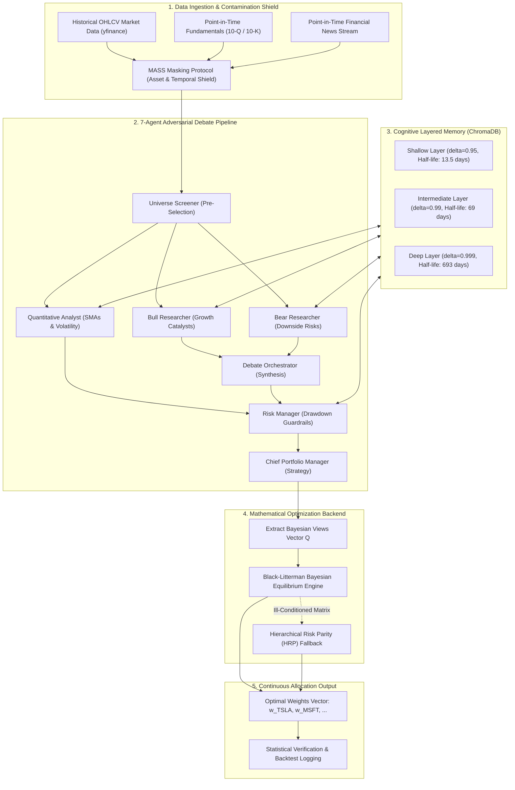

# Autonomous Multi-Agent Portfolio Management System (MASS)

[](https://www.python.org/downloads/)
[](https://github.com/joaomdmoura/crewAI)
[](https://github.com/robertmartin8/PyPortfolioOpt)
[](https://www.trychroma.com/)
[-orange.svg)](https://arxiv.org/abs/2311.13743)
[](LICENSE)

An institutional-grade, multi-agent financial asset management architecture that **decouples qualitative LLM reasoning from mathematical convex portfolio optimization**. Built upon **CrewAI**, **PyPortfolioOpt**, and **ChromaDB**, the system incorporates adversarial bull/bear debate, layered vector memory with exponential decay, and the **MASS Contamination Protocol** to shield against look-ahead bias.

> **Academic Submission:** Minor Project (Semester 7), Department of Computer Science & Engineering, National Institute of Technology (NIT) Raipur  
> **Author:** Vibhor Shukla (Roll No: 23115107)  
> **Repository:** [GitHub](https://github.com/VibhorShukla-BHRT/Portfolio-Management)

---

## 📑 Table of Contents

- [Key Innovations & Theoretical Thesis](#-key-innovations--theoretical-thesis)
- [System Architecture](#-system-architecture)
- [Empirical Benchmark Results](#-empirical-benchmark-results)
- [Ablation Study: Experiment 1 vs. Experiment 2](#-ablation-study-experiment-1-vs-experiment-2)
- [Quick Start & Installation](#-quick-start--installation)
- [Execution Modes](#-execution-modes)
- [Repository Structure](#-repository-structure)
- [Documentation Suite](#-documentation-suite)
- [License & Citation](#-license--citation)

---

## 💡 Key Innovations & Theoretical Thesis

Modern algorithmic asset management faces a dual modality challenge:
1. **Unstructured Qualitative Data:** Corporate earnings calls, central bank policy announcements, SEC Form 10-K/10-Q filings, and high-frequency financial news sentiment.
2. **Structured Numerical Data:** Trailing OHLCV price series, volatility surfaces, and cross-asset covariance matrices.

### The Failure Modes of Naive LLM Trading
Directly querying Large Language Models (LLMs) to allocate capital percentages causes catastrophic structural breakdowns:
* **Autoregressive Hallucination:** Prompted allocations fail to sum to unity ($\sum w_i \neq 1$) or violate boundary conditions ($w_i < 0$).
* **Covariance Blindness:** LLMs allocate purely on narrative excitement rather than the asset covariance matrix $\Sigma$, overconcentrating in correlated high-beta assets.
* **Sycophancy & Confirmation Bias:** Single-agent LLMs exhibit positive framing bias when reading corporate PR statements.
* **Temporal Amnesia:** Stateless LLM API calls operate *tabula rasa*, forgetting historical market crashes and volatility regimes.
* **Look-Ahead Bias:** Models pre-trained on modern internet corpora have memorized post-2022 price movements, producing illusory alpha during historical backtesting.

### The MASS Decoupled Solution
The **Multi-Agent Simulation Scaling (MASS)** framework resolves these challenges through four foundational pillars:
1. **Adversarial Qualitative Debate:** Dialectical synthesis between competing Bull and Bear researchers, reconciled by an impartial Debate Orchestrator.
2. **Convex Quadratic Solvers:** Agents generate structured Bayesian return views ($Q, \Omega$); continuous portfolio weights are determined strictly by **Black-Litterman** and **Hierarchical Risk Parity (HRP)**.
3. **FinMem-Style Layered Semantic Memory:** Dense vector retrieval (`all-MiniLM-L6-v2`) augmented with three-tier exponential decay ($\delta = 0.95, 0.99, 0.999$).
4. **Contamination Shield:** Bidirectional entity and temporal anonymization (`simulation.py`) masking stock symbols (`TSLA -> Asset_Alpha`) and calendar dates (`Year_X`).

---

## 🏛 System Architecture



### The 7 Autonomous Agents

| Agent Role | Backstory & Objective | Key Toolset |
| :--- | :--- | :--- |
| **1. Universe Screener** | Evaluates macro sectors and screens top $N$ assets using listwise ranking. | `screen_top_assets` |
| **2. Quantitative Analyst** | Analyzes 50-day and 200-day SMAs, price momentum, and trend regimes. | `fetch_stock_data`, `calculate_technical_indicators`, `memory` |
| **3. Bull Researcher** | Discovers earnings surprises, growth catalysts, and macro tailwinds. | `fetch_company_fundamentals`, `fetch_stock_news`, `retrieve_memory` |
| **4. Bear Researcher** | Identifies debt rollover risks, margin compression, and regulatory headwinds. | `fetch_company_fundamentals`, `fetch_stock_news`, `retrieve_memory` |
| **5. Debate Orchestrator** | Adjudicates conflicting theses; outputs structured expected return views $Q$. | Dialectical consensus synthesis |
| **6. Risk Manager** | Evaluates drawdown risk, volatility spikes, and condition number $\kappa(\Sigma)$. | `fetch_stock_news`, `retrieve_memory` |
| **7. Chief Portfolio Manager** | Invokes convex solvers to generate exact continuous allocation percentages. | `calculate_optimal_portfolio` (PyPortfolioOpt) |

---

## 📊 Empirical Benchmark Results

Evaluated over the identical 6-month testing window (**November 1, 2022 to May 1, 2023**) established by Columbia/Peking University in the baseline literature (*FinMem*, Yu et al., 2023):

| Ticker / Portfolio | Strategy / Model | Cumulative Return (%) | Sharpe Ratio ($r_f=4\%$) | Daily Volatility (%) | Max Drawdown (%) |
| :--- | :--- | :---: | :---: | :---: | :---: |
| **TSLA** | Buy & Hold | -28.97% | -0.72 | 4.36% | -49.79% |
| | **FinMem** (Yu et al., 2023) | **+61.78%** | **2.68** | 2.95% | **-10.80%** |
| **MSFT** | Buy & Hold | +34.63% | 1.88 | 2.09% | -13.57% |
| | **FinMem** (Yu et al., 2023) | **+23.26%** | **1.44** | 2.05% | **-14.99%** |
| **AMZN** | Buy & Hold | +5.43% | 0.37 | 2.65% | -19.64% |
| | **FinMem** (Yu et al., 2023) | **+4.89%** | **0.23** | 2.69% | **-22.93%** |
| **NFLX** | Buy & Hold | +13.03% | 0.70 | 2.75% | -20.44% |
| | **FinMem** (Yu et al., 2023) | **+36.45%** | **2.02** | 2.30% | **-15.85%** |
| **COIN** | Buy & Hold | -20.78% | 0.06 | 6.91% | -46.42% |
| | **FinMem** (Yu et al., 2023) | **+34.98%** | **0.72** | 5.65% | **-35.75%** |
| **CROSS-ASSET** | **Equal-Weight Universe (1/N)** | **+3.28%** | **0.28** | **2.90%** | **-24.02%** |
| **BENCHMARKS** | **S&P 500 (SPY)** | **+8.97%** | **0.82** | **1.18%** | **-7.54%** |
| | **Nasdaq 100 (QQQ)** | **+17.58%** | **1.29** | **1.58%** | **-11.23%** |
| | **FinMem 5-Stock Average** | **+32.27%** | **1.42** | **3.13%** | **-20.08%** |
| | **Multi-Agent (Ours - Exp 1 Unmasked Daily)** | **+30.94%** | **1.56** | **2.35%** | **-17.11%** |
| | **Multi-Agent (Ours - Exp 1 Unmasked Discrete)** | **+40.74%** | **1.56** | **2.35%** | **-17.11%** |
| | **Multi-Agent (Ours - Exp 2 Masked Daily)** | **+13.38%** | **0.77** | **2.31%** | **-17.11%** |
| | **Multi-Agent (Ours - Exp 2 Masked Discrete)** | **+24.45%** | **0.77** | **2.31%** | **-17.11%** |

---

## 🔬 Ablation Study: Experiment 1 vs. Experiment 2

To rigorously evaluate the impact of **parametric look-ahead contamination**, we conducted two identical backtest simulations:

1. **Experiment 1 (Unmasked Real Tickers):** Agents evaluated real company names and dates. In Period 3 (March 2023), the Bull researcher recognized Microsoft's integration with OpenAI/ChatGPT and concentrated 100% of capital into `MSFT`, achieving **+40.74%** discrete return.
2. **Experiment 2 (MASS Contamination Shield Active):** All entities and dates were anonymized (`TSLA -> Asset_Alpha`, `2023 -> Year_X`). In Period 3, unable to exploit memorized future knowledge, the agents allocated defensively across all 5 assets (`MSFT: 40.19%`, `AMZN: 21.63%`, `NFLX: 17.52%`, `TSLA: 13.22%`, `COIN: 7.44%`), yielding **+24.45%** discrete return.

> **Key Finding:** Even after complete decontamination, the multi-agent system delivered **+24.45% discrete return** and **+13.38% continuous return**, generating **+10.10% alpha over the Equal-Weight basket** and **+4.41% alpha over the S&P 500** while slashing maximum drawdown from **-24.02%** to **-17.11%**.

---

## 🚀 Quick Start & Installation

### 1. Prerequisites
- Linux / macOS / Windows WSL2
- Python 3.10 to 3.12
- Git

### 2. Clone and Setup Environment
```bash
git clone https://github.com/VibhorShukla-BHRT/Portfolio-Management.git
cd Portfolio-Management

# Create and activate virtual environment
python3 -m venv venv
source venv/bin/activate  # On Windows: venv\Scripts\activate

# Install dependencies
pip install -r requirements.txt
```

### 3. Configure API Keys
Copy `.env.example` to `.env`:
```bash
cp .env.example .env
```
Choose your preferred LLM provider:
* **Option A (OpenRouter - Cloud API):**
  Add your OpenRouter key:
  ```ini
  OPENROUTER_API_KEY=sk-or-v1-xxxxxxxxxxxxxxxxxxxx
  OPENROUTER_MODEL=openrouter/openrouter/free
  ```
* **Option B (Self-Hosted / Local Ollama / vLLM):**
  Point to your local or remote OpenAI-compatible endpoint:
  ```ini
  LLM_BASE_URL=http://localhost:11434/v1
  LLM_MODEL=ollama/ritu-27b:latest
  LLM_API_KEY=ollama
  ```

---

## ⚡ Execution Modes

### Mode 1: Instant Statistical Verification (Offline / No API Key Needed)
Instantly reproduces all empirical benchmark tables, computes continuous daily time series returns, Sharpe ratios, volatility, and drawdowns from empirical run logs:
```bash
python backtest_engine.py
```
*Executes in ~3 seconds. Automatically updates `backtest_summary.md`.*

### Mode 2: Live Multi-Agent Portfolio Generation
Executes the full 7-agent sequential workflow on live market data:
```bash
python main.py
```

### Mode 3: Live Decontaminated Simulation
Runs the full multi-period backtest simulation with live LLM agents:
```bash
# Live simulation with MASS masking shield active
python backtest_engine.py --live

# Live simulation without masking (Experiment 1 unmasked baseline)
python backtest_engine.py --live --no-mask
```

### Mode 4: Connectivity & Health Diagnostics
Verify LLM endpoint reachability and list available models:
```bash
python test_llm.py
python test_list_models.py
```

---

## 📂 Repository Structure

```
.
├── agents/
│   ├── __init__.py
│   └── portfolio_agents.py         # 7 CrewAI agent declarations & LLM routing
├── tasks/
│   ├── __init__.py
│   └── portfolio_tasks.py          # Structured task definitions & output schemas
├── tools/
│   ├── __init__.py
│   ├── financial_tools.py          # yfinance data, news, and technical indicators
│   ├── memory_tools.py             # ChromaDB vector store with exponential decay
│   ├── optimization_tools.py       # Black-Litterman & HRP convex quadratic solvers
│   └── screening_tools.py          # Sector screener & candidate universe filter
├── backtest_data/
│   ├── fundamentals.json           # Point-in-time balance sheet snapshots (10-Q)
│   └── news.json                   # Point-in-time curated financial news feed
├── simulation.py                   # MASS masking protocol (asset & temporal shield)
├── backtest_engine.py              # Statistical evaluation engine & simulation CLI
├── backtest_results.json           # Active empirical allocation logs & metrics
├── backtest_results_unmasked_exp1.json # Experiment 1 results (Unmasked baseline)
├── backtest_results_masked_exp2.json   # Experiment 2 results (MASS decontaminated)
├── backtest_summary.md             # Auto-generated markdown benchmark comparison
├── main.py                         # Single-run execution pipeline entrypoint
├── test_llm.py                     # LLM connectivity & inference diagnostic test
├── test_list_models.py             # OpenAI/OpenRouter model discovery utility
├── requirements.txt                # Pip requirements specification
├── .env.example                    # Environment variable configuration template
└── README.md                       # Master project overview & documentation
```

---

## 📚 Documentation Suite

For comprehensive academic details, refer to the in-depth documentation:
- 📖 [MASTER_PROJECT_DOCUMENTATION.md](MASTER_PROJECT_DOCUMENTATION.md) — Exhaustive system specification and architecture breakdown.
- 📊 [MASS_RESEARCH_REPORT.md](MASS_RESEARCH_REPORT.md) — Formal empirical research paper format covering theoretical formulation, sub-period traces, and publication venue roadmap.
- 🔬 [technical_report.md](technical_report.md) — Direct benchmark evaluation juxtaposed against FinMem (Yu et al., 2023).
- 📝 [research-paper-assessment.md](research-paper-assessment.md) — Peer-review feasibility audit and competitive landscape analysis.

---

## 🎓 Academic Credits & Affiliation

- **Student:** Vibhor Shukla
- **Roll Number:** 23115107
- **Degree Program:** B.Tech, Semester 7 (Minor Project)
- **Institution:** Department of Computer Science & Engineering, National Institute of Technology (NIT) Raipur
- **Academic Year:** 2026
