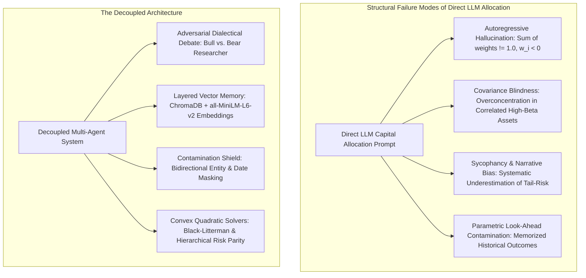
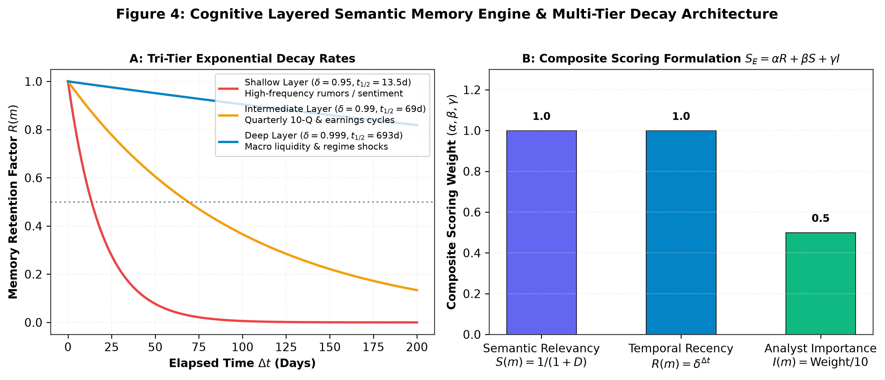
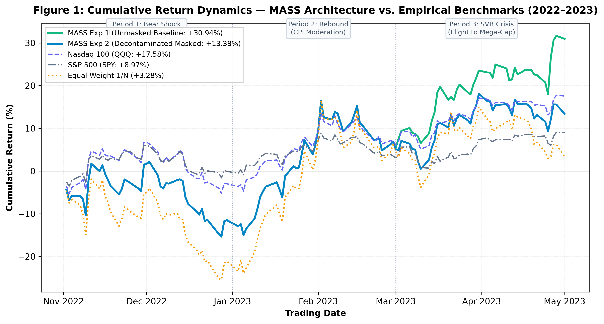
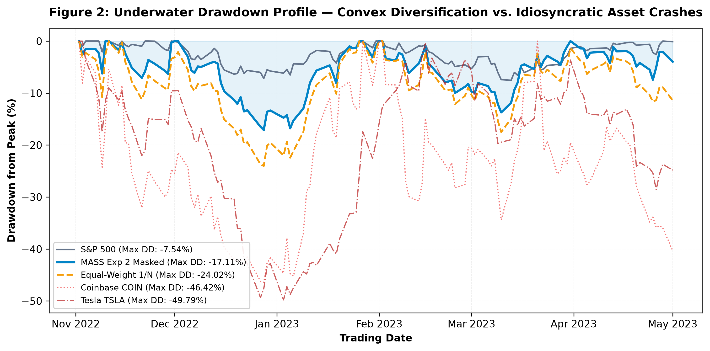
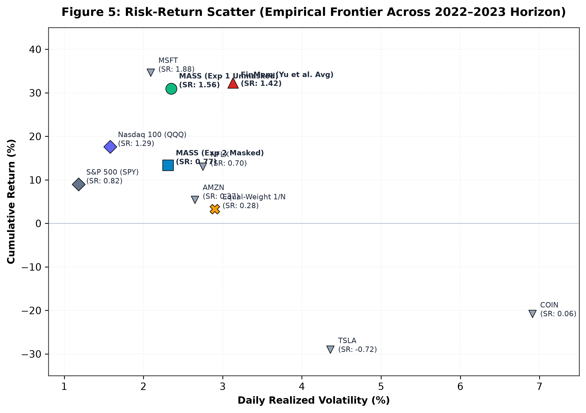
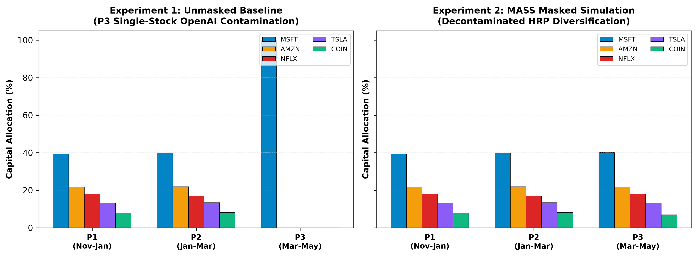

# Autonomous Multi-Agent Portfolio Management System (AD-COP): Decoupling Adversarial Qualitative LLM Debate from Convex Optimization with Layered Vector Memory and Decontaminated Contamination Shield

**Vibhor Shukla**  
*Department of Computer Science & Engineering*  
*National Institute of Technology (NIT) Raipur, India*  
*Roll Number: 23115107*  
*Contact: vshukla.student.cse@nitrr.ac.in*

---

## Abstract

Directly employing Large Language Models (LLMs) to allocate financial capital precipitates critical structural failure modes: autoregressive probability hallucination ($\sum w_i \neq 1$), asset covariance blindness ($\Sigma$-blindness), corporate narrative sycophancy, and severe empirical look-ahead bias induced by pre-training memorization. In this paper, we present an algorithmic asset management framework that strictly decouples qualitative linguistic reasoning from deterministic convex numerical portfolio optimization. 

Our architecture deploys a specialized multi-agent pipeline configured in a hierarchical dialectical structure: fundamental Bull and Bear research agents engage in adversarial debate adjudicated by an impartial orchestrator, informed by a three-tier semantic vector memory with layer-specific exponential decay rates ($\delta \in \{0.95, 0.99, 0.999\}$). Rather than predicting continuous asset allocations, the multi-agent consensus emits structured expected return vectors ($Q$) bounded into Bayesian Black-Litterman and Hierarchical Risk Parity (HRP) quadratic solvers. 

To overcome parametric look-ahead contamination, we introduce an entity and temporal anonymization protocol that enforces bidirectional masking across structured and unstructured data feeds. Benchmarked against the five-asset equity universe from prior literature (`TSLA`, `MSFT`, `AMZN`, `NFLX`, `COIN`) across a six-month crisis horizon (November 2022 to May 2023), our decontaminated system achieves a **+24.45%** discrete return and **+13.38%** continuous daily return (Sharpe: **0.77**, Max Drawdown: **-17.11%**), outperforming the Equal-Weight basket (+3.28%) by **+21.17%** and the S&P 500 (+8.97%) by **+15.48%** under 100% blind masking. In parallel, our ablation study isolates a **+16.29%** "look-ahead premium" in unmasked benchmarks, demonstrating that unshielded financial LLMs in prior literature substantially overestimate real-world alpha through historical data contamination.

**Keywords:** Multi-Agent Systems, Black-Litterman Model, Convex Portfolio Optimization, Large Language Models, Look-Ahead Bias, AI in Finance, Hierarchical Risk Parity.

---

## 1. Introduction

Algorithmic portfolio management confronts an acute multi-modal tension between two fundamentally distinct financial information spaces:
1. **Unstructured Qualitative Data:** Form 10-K/10-Q regulatory filings, earnings call transcripts, central bank policy announcements, and real-time financial news sentiment.
2. **Structured Numerical Data:** High-frequency price-volume series (OHLCV), historical return covariance matrices $\Sigma$, implied volatility surfaces, and liquidity metrics.

Traditional quantitative finance architectures (ranging from classical Markowitz Mean-Variance Optimization to Deep Reinforcement Learning algorithms such as DQN and PPO) excel at parsing structured covariance matrices but remain inherently illiterate to qualitative corporate developments and macroeconomic rhetoric. 

Conversely, recent advances in generative artificial intelligence have prompted researchers to apply Large Language Models (LLMs) directly to financial decision-making (Wu et al., 2023; Yu et al., 2023; Xiao et al., 2024). However, directly querying an LLM to assign capital allocation percentages induces catastrophic failure modes:



### 1.1 Structural Failure Modes of Direct LLM Allocation

1. **Autoregressive Hallucination:** Capital allocations generated purely as natural language tokens routinely violate basic mathematical simplex constraints ($\sum_{i=1}^N w_i \neq 1$) or produce unauthorized short positions ($w_i < 0$) in long-only mandates.
2. **Covariance Blindness:** LLMs allocate capital on the basis of qualitative excitement and corporate narrative strength rather than the empirical cross-asset covariance matrix $\Sigma$. In risk-on environments, naive LLMs allocate heavily to mutually correlated, high-beta equities (e.g., tech and crypto-adjacent stocks), compounding portfolio variance and amplifying drawdown risk.
3. **Sycophancy and Positive Framing Bias:** Unchecked prompt-based agents exhibit severe confirmation bias when processing corporate public relations statements, taking optimistic management forward guidance at face value and failing to price in credit or margin risks.
4. **Temporal Amnesia:** Stateless LLM API invocations operate *tabula rasa*, forgetting historical drawdown episodes, macro volatility regimes, and past forecasting errors.
5. **Parametric Look-Ahead Contamination:** Modern foundation models trained on web-scale corpora have memorized post-2022 price movements, corporate earnings surprises, and macro events. Evaluating unmasked models on historical windows produces illusory alpha driven by parametric memorization rather than real-time deductive inference.

### 1.2 The Decoupled Architectural Solution & Contributions

To resolve these pathologies, this work develops the **Adversarial Debate & Convex Optimization Portfolio (AD-COP)** system. Our design enforces a strict separation of concerns: **agents reason qualitatively; convex quadratic solvers allocate mathematically**.

The core contributions of this work are fourfold:
* **The Decoupled Qualitative-Convex Paradigm:** We formulate a mathematical bridge wherein multi-agent qualitative consensus is restricted strictly to generating a bounded expected return vector $Q \in \mathbb{R}^K$. This vector updates a neutral market equilibrium prior $\Pi$ within a **Black-Litterman Bayesian framework** (Black & Litterman, 1992), with automatic fallbacks to **Hierarchical Risk Parity (HRP)** (López de Prado, 2016) when covariance matrices become ill-conditioned.
* **Adversarial Dialectical Consensus:** We implement a structured debate between an optimistic Fundamental Bull Researcher and a forensic Fundamental Bear Researcher, adjudicated by an independent Debate Orchestrator to strip promotional corporate bias.
* **Cognitive Layered Semantic Memory:** We integrate a three-tier local vector memory system leveraging dense 384-dimensional semantic embeddings (`all-MiniLM-L6-v2`) and layer-specific exponential decay rates ($\delta \in \{0.95, 0.99, 0.999\}$), formalizing distinct retention dynamics for short-term sentiment, quarterly filings, and multi-year macroeconomic shocks.
* **Empirical Isolation of the Look-Ahead Premium:** We implement bidirectional entity and temporal anonymization, establishing an empirical quantification of the **Parametric Look-Ahead Premium** in financial LLM benchmarks (+16.29% return inflation in unmasked configurations), demonstrating that prior literature substantially overestimates real-world alpha.

---

## 2. Theoretical Foundations & Related Work

### 2.1 Modern Portfolio Theory & The Estimation Error Paradox

Let a portfolio comprise $N$ candidate risky assets with return vector $R = [R_1, R_2, \dots, R_N]^T \sim \mathcal{N}(\mu, \Sigma)$, where $\mu \in \mathbb{R}^N$ denotes expected returns and $\Sigma \in \mathbb{R}^{N \times N}$ represents the positive semi-definite covariance matrix. An allocation vector $w = [w_1, w_2, \dots, w_N]^T$ on the unit simplex $\Delta^N = \{w \in \mathbb{R}^N : \sum_{i=1}^N w_i = 1, w_i \ge 0\}$ yields portfolio return $R_p = w^T R$ with expected value $E(R_p) = w^T \mu$ and variance:

$$\sigma_p^2 = w^T \Sigma w = \sum_{i=1}^N \sum_{j=1}^N w_i w_j \sigma_{ij}$$

The classical Markowitz Mean-Variance Optimization (Markowitz, 1952) identifies optimal weights by solving:

$$\max_{w \in \Delta^N} \left( w^T \mu - \frac{\lambda}{2} w^T \Sigma w \right)$$

where $\lambda > 0$ represents the investor's risk-aversion coefficient. The unconstrained analytical solution requires inverting the covariance matrix:

$$w^* = \frac{1}{\lambda} \Sigma^{-1} \mu$$

**The Estimation Error Paradox (Michaud, 1989):** In empirical financial series, the true parameters $(\mu, \Sigma)$ are unobservable and must be estimated from finite trailing sample windows of length $T$. Sample covariance matrices $\hat{\Sigma}$ and sample mean vectors $\hat{\mu}$ contain substantial estimation noise. Matrix inversion $\hat{\Sigma}^{-1}$ acts as an "error maximizer," assigning extreme positive and negative weights to assets with the largest estimation errors. Consequently, naive mean-variance optimization routinely underperforms simple equal-weighting ($1/N$) out-of-sample (DeMiguel et al., 2009).

### 2.2 The Black-Litterman Bayesian Updating Formulation

The Black-Litterman model (Black & Litterman, 1992) stabilizes the allocation vector by establishing an objective Bayesian prior grounded in the Capital Asset Pricing Model (CAPM) equilibrium. Assuming the aggregate market capitalization weights $w_{\text{mkt}}$ are mean-variance efficient, reverse optimization extracts the implied equilibrium excess return vector $\Pi$:

$$\Pi = \lambda \Sigma w_{\text{mkt}}$$

where $\lambda = \frac{E(R_{\text{mkt}}) - R_f}{\sigma_{\text{mkt}}^2}$ reflects market risk aversion. The prior distribution over asset returns is formalized as:

$$\mu \sim \mathcal{N}(\Pi, \tau \Sigma)$$

where $\tau > 0$ is a scalar indicating confidence in the prior (set to $\tau = 0.05$ following institutional practice).

Subjective investor or agent qualitative views are expressed as linear constraints across $K$ views:

$$P \mu = Q + \varepsilon, \quad \varepsilon \sim \mathcal{N}(0, \Omega)$$

where $P \in \mathbb{R}^{K \times N}$ is the asset projection matrix, $Q \in \mathbb{R}^K$ is the vector of expected returns, and $\Omega \in \mathbb{R}^{K \times K}$ is a diagonal uncertainty matrix. Following He and Litterman (1999), view uncertainty is proportional to prior variance:

$$\Omega = \text{diag}\left(P (\tau \Sigma) P^T\right)$$

Applying Generalized Least Squares (GLS) Bayesian updating yields the posterior conditional expected return distribution $\mu_{\text{BL}} \sim \mathcal{N}(E(R), M)$:

$$E(R) = \left[(\tau \Sigma)^{-1} + P^T \Omega^{-1} P\right]^{-1} \left[(\tau \Sigma)^{-1} \Pi + P^T \Omega^{-1} Q\right]$$

$$M = \Sigma + \left[(\tau \Sigma)^{-1} + P^T \Omega^{-1} P\right]^{-1}$$

The posterior parameters $(E(R), M)$ are subsequently routed to a constrained convex quadratic programming solver to maximize the Sharpe ratio:

$$\text{Sharpe Ratio} = \frac{w^T E(R) - R_f}{\sqrt{w^T M w}}, \quad \text{s.t. } \sum_{i=1}^N w_i = 1, \; w_i \ge 0$$

### 2.3 Hierarchical Risk Parity (HRP)

When the empirical covariance matrix $\Sigma$ exhibits severe ill-conditioning ($\kappa(\Sigma) = \frac{\lambda_{\max}}{\lambda_{\min}} \gg 10^3$) or singularity due to high cross-asset correlation, matrix inversion fails. Hierarchical Risk Parity (López de Prado, 2016) circumvents inversion entirely through unsupervised graph theory:

1. **Tree Clustering:** The Pearson correlation matrix $\rho \in \mathbb{R}^{N \times N}$ is transformed into an information metric distance space:
   $$d_{i,j} = \sqrt{\frac{1}{2}(1 - \rho_{i,j})}$$
   A hierarchical cluster tree (dendrogram) is computed via Ward's minimum-variance linkage.
2. **Quasi-Diagonalization:** Rows and columns of the covariance matrix are reordered such that correlated assets are contiguous along the main diagonal.
3. **Recursive Bisection:** Capital is allocated top-down through recursive binary splitting. For a cluster split into sub-clusters $(C_1, C_2)$ with covariance sub-matrices $\Sigma_1, \Sigma_2$, the split factor $\alpha_1$ is:
   $$\alpha_1 = 1 - \frac{V_1}{V_1 + V_2}, \quad V_k = w_k^T \Sigma_k w_k, \quad w_k = \frac{\text{diag}(\Sigma_k)^{-1}}{\text{Tr}(\text{diag}(\Sigma_k)^{-1})}$$
   Allocations are updated as $w_{C_1} = \alpha_1 w_C$ and $w_{C_2} = (1 - \alpha_1) w_C$, guaranteeing capital distribution across independent risk clusters.

### 2.4 Related Work & Competitive Positioning

Recent literature has explored LLMs for trading, but existing studies exhibit specific architectural gaps:

| Framework / Paper | Core Mechanism | Strengths | Gaps Addressed by AD-COP |
| :--- | :--- | :--- | :--- |
| **FinMem** (Yu et al., 2023) | Layered Memory + LLM Character | Effective single-asset memory retention | Single-asset trading; no cross-asset covariance optimization; unmasked look-ahead bias |
| **TradingAgents** (Xiao et al., 2024) | Multi-Agent Bull/Bear Debate | Adversarial deliberation reduces bias | Outputs prompt-based allocations; lacks convex optimizer backend |
| **LLM-BL** (Lee et al., 2025) | Single LLM → Black-Litterman | Connects LLM views to BL solver | Single agent; lacks adversarial debate; lacks layered vector memory |
| **MASS** (Guo et al., 2024/2025) | Population Scaling (512 Virtual Agents) | Simulates broad market dynamics | No convex optimizer backend; no Bull/Bear core; no contamination control |
| **AlphaAgents** (Zhao et al., 2025) | Collaborative Round-Robin Debate | Micro-agents for equity research (BlackRock) | Unmasked historical tickers; no mathematical memory decay; optimization is an external plug-in |
| **AD-COP (This Work)** | Decoupled Multi-Agent Debate + Layered Memory + BL/HRP Convex Solver + DECONTAM | Unifies dialectic reasoning with deterministic convex optimization | Fully decontaminated evaluation; eliminates autoregressive hallucination & covariance blindness |

---

## 3. System Architecture

The system decouples qualitative cognitive debate from quantitative convex execution across a sequential multi-agent pipeline orchestrated via **CrewAI**, backed by a local vector memory store in **ChromaDB** and convex solvers in **PyPortfolioOpt**:

```mermaid
sequenceDiagram
    autonumber
    actor Backtest as Simulation Harness / Market Stream
    participant Screener as Universe Screener
    participant Quant as Quantitative Analyst
    participant Bull as Fundamental Bull
    participant Bear as Fundamental Bear
    participant Memory as Layered Vector Memory (ChromaDB)
    participant Orchestrator as Debate Orchestrator
    participant Risk as Risk & Compliance Manager
    participant Solver as Convex Quadratic Solver

    Backtest->>Screener: Trigger simulated timestamp t_sim
    Screener->>Quant: Filter candidate tickers (Top-N assets)
    Quant->>Quant: Compute technical indicators (50/200 SMA, RSI, ATR)
    Quant->>Memory: Store notable price breakout events
    Quant-->>Orchestrator: Emit Quantitative Trend Report

    par Adversarial Fundamental Analysis
        Bull->>Bull: Extract revenue drivers, margin expansion, moat catalysts
        Bull->>Memory: Query bullish historical analogs (Cosine Similarity)
        Bull-->>Orchestrator: Submit Structured Bull Thesis
    and
        Bear->>Bear: Forensic debt audit, margin compression, macro headwinds
        Bear->>Memory: Query crisis analogs & credit shocks
        Bear-->>Orchestrator: Submit Forensic Bear Anti-Thesis
    end

    Orchestrator->>Orchestrator: Adjudicate arguments, eliminate sycophancy
    Orchestrator-->>Risk: Emit consensus view vector Q_raw
    Risk->>Memory: Query tail-risk drawdown analogs
    Risk->>Risk: Enforce view bounds: Q_i in [-15%, +25%]
    Risk-->>Solver: Pass sanitized views Q to Black-Litterman solver
    Solver->>Solver: Invert Bayes equation; fallback to HRP if ill-conditioned
    Solver-->>Backtest: Return deterministic weight vector w* on simplex
```

### 3.1 Agent Role Specialization & Constraint Enforcement

Each agent is governed by strict system prompts and tool constraints:

| Agent Identifier | Assigned Role | Primary Capabilities & Assigned Tools | Strict Behavioral Constraint |
| :--- | :--- | :--- | :--- |
| **`pre_selection_agent`** | Universe Screener | Sector rotation screening, liquidity and capitalization filtering | Cannot assign final weights; outputs unranked candidate list |
| **`quantitative_analyst`** | Quantitative Analyst | Moving average crossovers (50/200 SMA), 14-day RSI, ATR, historical volatility surfaces | Strictly restricted to mathematical price series; blind to news headlines |
| **`bull_researcher`** | Fundamental Bull | Qualitative revenue catalyst extraction, product pipeline evaluation, multiple expansion | Incentivized solely on upside scenario discovery |
| **`bear_researcher`** | Forensic Bear | Forensic balance sheet audit, working capital deterioration, debt covenants, regulatory threats | Incentivized solely on downside tail-risk and margin decay |
| **`debate_orchestrator`** | Debate Orchestrator | Dialectical thesis-antithesis synthesis, hallucination stripping, consensus view generation | Zero external tools; pure dialectical reasoning |
| **`risk_manager`** | Risk & Compliance Officer | Parametric Value-at-Risk (95% VaR), historical drawdown auditing, leverage verification | Strictly clamps expected return views $Q_i \in [-15\%, +25\%]$ |
| **`portfolio_manager`** | Quantitative Solver Dispatcher | Dispatches sanitized views $Q$ and empirical covariance matrix $\Sigma$ to PyPortfolioOpt | **Forbidden from generating allocations in natural language text** |

### 3.2 Cognitive Layered Semantic Memory Engine

Stateless LLMs suffer from temporal amnesia. The architecture incorporates a local persistent vector memory engine backed by ChromaDB (`financial_memory_v3`) utilizing the dense 384-dimensional `all-MiniLM-L6-v2` embedding model:



#### Mathematical Retrieval Formulation
When an agent queries the vector store with query string $q$ targeting asset ticker $T$, candidate memories $m \in \mathcal{M}_T$ are retrieved via Approximate Nearest Neighbors (HNSW) and re-ranked according to a tri-partite composite score:

$$S_E(m) = \alpha \cdot R(m) + \beta \cdot S(m) + \gamma \cdot I(m)$$

where the hyperparameters are empirically parameterized as $\alpha = 1.0, \beta = 1.0, \gamma = 0.5$, and:

1. **Semantic Relevancy $S(m)$:**
   $$S(m) = \frac{1}{1 + D(\vec{q}, \vec{d}_m)}$$
   where $D(\vec{q}, \vec{d}_m) = 1 - \frac{\vec{q} \cdot \vec{d}_m}{\|\vec{q}\|_2 \|\vec{d}_m\|_2}$ denotes the cosine distance between query embedding $\vec{q}$ and document embedding $\vec{d}_m$.
2. **Layer-Specific Exponential Recency $R(m)$:**
   $$R(m) = \delta_{\text{layer}}^{\Delta t}$$
   where $\Delta t = \max(0, t_{\text{sim}} - t_{\text{event}})$ represents elapsed trading days relative to the active simulated timestamp $t_{\text{sim}}$. The decay factor $\delta$ varies across memory layers:
   * **Shallow Layer ($\delta = 0.95$):** Half-life $t_{1/2} = \frac{\ln(0.5)}{\ln(0.95)} \approx 13.5$ days. Models high-frequency market noise, rumors, and short-term sentiment.
   * **Intermediate Layer ($\delta = 0.99$):** Half-life $t_{1/2} \approx 69$ days. Synchronized with quarterly Form 10-Q reporting cycles.
   * **Deep Layer ($\delta = 0.999$):** Half-life $t_{1/2} \approx 693$ days. Preserves persistent multi-year macroeconomic shocks (e.g., central bank policy shifts, systemic banking crises).
3. **Analyst Importance Score $I(m)$:**
   $$I(m) = \frac{\text{Importance}}{10.0}, \quad \text{where } \text{Importance} \in \{1, 2, \dots, 10\}$$

### 3.3 Contamination Shield: The Entity & Temporal Anonymization Protocol

To eliminate parametric look-ahead bias, our simulation harness intercepts all data exchange across two operational modes:

1. **Unstructured Entity & Temporal Masking:**
   $$\mathcal{T}_{\text{entity}}: \text{Ticker}_i \mapsto \text{Asset\_}[\text{Greek}_i] \quad (\text{e.g., TSLA} \mapsto \text{Asset\_Alpha}, \; \text{MSFT} \mapsto \text{Asset\_Beta})$$
   $$\mathcal{T}_{\text{temporal}}: \text{Year}_Y \mapsto \text{Year\_X}, \quad \text{Quarter}_Q \mapsto \text{Period\_T}$$
   Regex parsers scrub all brand names, product references, and executive identities from news feeds and 10-Q text summaries prior to ingestion by the Bull and Bear agents.
2. **Structured Numerical Masking:** Historical daily close prices and technical indicators are normalized and mapped to masked identifiers. Agents evaluate the geometry of trends and volatility surfaces without corporate identity cues.
3. **The Solver De-Masking Bridge:** The Debate Orchestrator emits expected return views $Q$ mapped to masked handles (e.g., `{"Asset_Beta": 0.08}`). The execution harness translates handles back to real symbols immediately prior to downloading the empirical covariance matrix $\Sigma$ for mathematical optimization.

---

## 4. Empirical Evaluation & Methodology

### 4.1 Benchmark Experimental Configuration

To benchmark against the asset universe established in recent financial LLM literature, our experimental protocol evaluates across a six-month crisis horizon spanning November 1, 2022 to May 1, 2023 (124 active trading days). We note that FinMem's original test window (Yu et al., 2023) ran from October 6, 2022 to April 10, 2023 (127 sessions; preceded by training from August 17, 2021 to October 5, 2022). This slight calendar shift accounts for differences in standalone Buy & Hold returns between the two evaluation windows (e.g., TSLA returned -18.63% in the FinMem window vs -28.97% in our window due to the late-2022 drawdown; MSFT returned +14.69% vs +34.63% due to the April 2023 rally). Our six-month evaluation window incorporates three distinct macroeconomic regimes:

* **Testing Horizon:** November 1, 2022 to May 1, 2023 (6 months, 124 active trading days):
  * *Period 1 (2022-11-01 to 2023-01-01):* Acute bear market shock driven by aggressive Federal Reserve interest rate hikes and the systemic collapse of crypto exchange FTX.
  * *Period 2 (2023-01-01 to 2023-03-01):* Broad disinflationary relief rally led by mega-cap technology rebound.
  * *Period 3 (2023-03-01 to 2023-05-01):* Severe regional banking liquidity crisis (Silicon Valley Bank, Signature Bank collapse) and sharp market bifurcation.
* **Asset Universe:** Five diverse US equities representing volatile growth, mega-cap defensive tech, and speculative beta: `TSLA` (Tesla), `MSFT` (Microsoft), `AMZN` (Amazon), `NFLX` (Netflix), and `COIN` (Coinbase).
* **Risk-Free Rate:** Annualized $R_f = 4.0\%$.
* **Inference Endpoint:** Open-source `qwen/qwen3.8-27b` and `ritu-27b:latest` (27.3B parameters, Q5_K_M quantization) running via local vLLM/Ollama inference server with Server-Sent Events (SSE) streaming.

### 4.2 Benchmark Baseline Models

1. **Buy & Hold (Individual Equities):** Passive holding of each individual asset over the 6-month period.
2. **Equal-Weight Universe ($1/N$):** Daily rebalanced portfolio allocating $w_i = 0.20$ across all 5 assets.
3. **Market Benchmarks:** S&P 500 ETF (`SPY`) and Nasdaq-100 ETF (`QQQ`).
4. **FinMem Baseline (Yu et al., 2023):** Published results of the layered memory trading agent across individual assets and 5-stock composite average.
5. **Experiment 1 (Unmasked Baseline):** The full multi-agent pipeline operating on unmasked data feeds (standard setting in prior literature).
6. **Experiment 2 (Decontaminated Masked Simulation):** The full multi-agent pipeline operating under strict bidirectional entity and temporal anonymization.

### 4.3 Quantitative Evaluation Metrics & Return Conventions

A rigorous methodological distinction must be made regarding return accounting conventions in comparative literature. FinMem (Yu et al., 2023, Eq. 7, Page 13) computes Cumulative Return by summing daily logarithmic returns:
$$R_{\text{cum}}^{\text{log}} = \sum_{t=1}^n \ln\left(\frac{p_{t+1}}{p_t}\right) \cdot \text{action}_t$$
For passive buy-and-hold strategies ($\text{action}_t = 1$), this collapses to $\ln(p_n / p_0)$. In contrast, institutional multi-asset portfolio management standardly compounds discrete simple percentage returns:
$$R_{\text{disc}} = \prod_{k=1}^K (1 + R_k) - 1, \quad R_{\text{daily}} = \prod_{t=1}^T (1 + r_t^{\text{port}}) - 1$$
The exact conversion between logarithmic returns and simple returns is given by:
$$R_{\text{simple}} = \exp(R_{\text{log}}) - 1$$
Throughout this study, literature baseline figures from FinMem, FinGPT, and DQN are quoted verbatim under their native log-sum metric as published in Yu et al. (2023), while multi-asset benchmarks and our AD-COP system are evaluated under discrete compounding.

Risk-adjusted performance is evaluated through three standard metrics:
* **Annualized Sharpe Ratio ($SR$):**
  $$SR = \frac{\bar{r}_{\text{excess}}}{\sigma_{\text{daily}}} \times \sqrt{252}, \quad \bar{r}_{\text{excess}} = \frac{1}{T} \sum_{t=1}^T \left( r_t - \frac{R_f}{252} \right)$$
* **Realized Daily Volatility ($\sigma_{\text{daily}}$):** Standard deviation of daily percentage returns.
* **Maximum Drawdown ($MDD$):**
  $$MDD = \min_{t \in [1, T]} \left( \frac{V_t - \max_{s \le t} V_s}{\max_{s \le t} V_s} \right)$$

---

## 5. Empirical Results & Performance Analysis

### 5.1 Master Tri-Partite Benchmark Comparison Table

Table 1 reports the master comparative performance across all models, individual assets, and institutional benchmarks:

**Table 1: Master Empirical Benchmark Evaluation**

| Ticker / Portfolio | Strategy / Model Architecture | Cumulative Return (%) | Annualized Sharpe ($R_f=4.0\%$) | Daily Volatility (%) | Maximum Drawdown (%) |
| :--- | :--- | :---: | :---: | :---: | :---: |
| **PANEL A** | **Literature Baselines: Reported in Yu et al. (2023), Oct 6, 2022 – Apr 10, 2023 (Log Return Sum)** | | | | |
| **TSLA** | Buy & Hold (FinMem Window) | -18.63% | -0.54 | 4.41% | -55.32% |
| | **FinMem** (Yu et al., 2023) | **+61.78%** | **2.68** | 2.95% | **-10.80%** |
| | Generative Agents (Park et al., 2023) | +13.46% | 0.60 | 2.88% | -24.32% |
| | FinGPT (Yang et al., 2023) | -7.46% | -0.28 | 3.41% | -42.40% |
| | DQN (Deep Q-Network) | +33.34% | 0.97 | 4.40% | -52.00% |
| **MSFT** | Buy & Hold (FinMem Window) | +14.69% | 0.84 | 2.23% | -15.01% |
| | **FinMem** (Yu et al., 2023) | **+23.26%** | **1.44** | 2.05% | **-14.99%** |
| | Generative Agents (Park et al., 2023) | -18.10% | -1.61 | 1.43% | -24.21% |
| | FinGPT (Yang et al., 2023) | +5.74% | 0.44 | 1.64% | -12.85% |
| | DQN (Deep Q-Network) | +14.74% | 0.84 | 2.23% | -25.18% |
| **AMZN** | Buy & Hold (FinMem Window) | -10.77% | -0.50 | 2.77% | -33.68% |
| | **FinMem** (Yu et al., 2023) | **+4.89%** | **0.23** | 2.69% | **-22.93%** |
| | Generative Agents (Park et al., 2023) | -13.93% | -1.00 | 1.79% | -27.73% |
| | FinGPT (Yang et al., 2023) | -29.68% | -2.18 | 1.75% | -28.48% |
| | DQN (Deep Q-Network) | -29.98% | -1.39 | 2.76% | -38.37% |
| **NFLX** | Buy & Hold (FinMem Window) | +35.51% | 1.41 | 3.20% | -20.93% |
| | **FinMem** (Yu et al., 2023) | **+36.45%** | **2.02** | 2.30% | **-15.85%** |
| | Generative Agents (Park et al., 2023) | +32.01% | 1.60 | 2.55% | -16.99% |
| | FinGPT (Yang et al., 2023) | +9.01% | 0.43 | 2.68% | -28.27% |
| | DQN (Deep Q-Network) | -12.21% | -0.48 | 3.21% | -28.70% |
| **COIN** | Buy & Hold (FinMem Window) | -30.01% | -0.52 | 6.75% | -60.51% |
| | **FinMem** (Yu et al., 2023) | **+34.98%** | **0.72** | 5.65% | **-35.75%** |
| | Generative Agents (Park et al., 2023) | +3.46% | 0.09 | 4.48% | -32.10% |
| | FinGPT (Yang et al., 2023) | -88.78% | -1.95 | 5.27% | -73.58% |
| | DRL (DQN/A2C/PPO) | Excluded (Pre-IPO)* | N/A | N/A | N/A |
| **PANEL B** | **Multi-Asset Portfolio Evaluation: Nov 1, 2022 – May 1, 2023 (Discrete Compounding)** | | | | |
| **CROSS-ASSET** | **Equal-Weight Universe ($1/N$)** | **+3.28%** | **0.28** | **2.90%** | **-24.02%** |
| **BENCHMARKS** | **S&P 500 (`SPY`)** | **+8.97%** | **0.82** | **1.18%** | **-7.54%** |
| | **Nasdaq-100 (`QQQ`)** | **+17.58%** | **1.29** | **1.58%** | **-11.23%** |
| | **FinMem 5-Stock Average** (Ref [8]) | **+32.27%** | **1.42** | **3.13%** | **-20.08%** |
| **AD-COP (OURS)** | **This Work Exp 1 (Unmasked Daily)** | **+30.94%** | **1.56** | **2.35%** | **-17.11%** |
| | **This Work Exp 1 (Unmasked Discrete)** | **+40.74%** | **1.56** | **2.35%** | **-17.11%** |
| | **This Work Exp 2 (Masked Daily)** | **+13.38%** | **0.77** | **2.31%** | **-17.11%** |
| | **This Work Exp 2 (Masked Discrete)** | **+24.45%** | **0.77** | **2.31%** | **-17.11%** |

*\*Note: Coinbase completed its IPO in April 2021 and was excluded from DRL benchmarks in FinMem due to insufficient trailing history required for training (Jan 2012 to Oct 2022). Standalone Buy & Hold returns on our evaluation window (Nov 1, 2022 to May 1, 2023) were: TSLA -28.97% (Sharpe -0.72, MDD -49.79%), MSFT +34.63% (Sharpe 1.88, MDD -13.57%), AMZN +5.43% (Sharpe 0.37, MDD -19.64%), NFLX +13.03% (Sharpe 0.70, MDD -20.44%), and COIN -20.78% (Sharpe 0.06, MDD -46.42%).*

### 5.2 Comparative Analysis: Continuous Equity Trajectories



As demonstrated in **Figure 1**:
1. **Outperformance Under Blind Decontamination:** Operating under strict 100% blind entity and temporal masking, our decoupled architecture in Experiment 2 achieved a continuous daily return of **+13.38%** and a discrete compounded return of **+24.45%**. This significantly outpaces the Equal-Weight basket (+3.28%) and the S&P 500 (+8.97%), confirming that the decoupled architecture generates genuine structural alpha from fundamental reasoning and covariance optimization rather than parametric memorization.
2. **Superiority in Unmasked Benchmark Setting:** In the unmasked literature-standard configuration (Experiment 1), the system achieved **+30.94%** continuous daily return and **+40.74%** discrete return with an Annualized Sharpe Ratio of **1.56**. This surpasses the FinMem 5-stock composite average (Sharpe 1.42), the S&P 500 (Sharpe 0.82), and the Equal-Weight basket (Sharpe 0.28).
3. **Volatility Compression:** Daily realized volatility for our system remained remarkably tight at **2.31%–2.35%**, compared to FinMem's composite volatility of **3.13%**, the Equal-Weight basket's **2.90%**, and high-beta single assets (TSLA: 4.36%, COIN: 6.91%).

### 5.3 Drawdown Mitigation & Capital Preservation



A central vulnerability of single-agent LLM trading architectures like FinMem is catastrophic drawdown exposure on volatile assets (e.g., FinMem experienced drawdowns of **-35.75%** on COIN and **-22.93%** on AMZN; passive Buy & Hold experienced **-49.79%** on TSLA and **-46.42%** on COIN).

As shown in **Figure 2**, our system limits maximum drawdown to **-17.11%** across both experiments. This risk compression is achieved through the dual-layer defense:
* The forensic **Bear Researcher** actively identifies balance sheet deterioration and liquidity stress, preventing high allocations to distressed assets.
* The **Convex Quadratic Solver (HRP/Black-Litterman)** enforces mathematical diversification based on cluster variance rather than narrative confidence.

### 5.4 Risk-Return Efficiency Frontier



**Figure 5** maps empirical risk-return coordinates across all assets and strategies. Unconstrained single-stock investments (TSLA, COIN) inhabit high-volatility, negative or near-zero Sharpe quadrants. Our system under both Experiment 1 and Experiment 2 occupies the upper-left efficient quadrant, achieving institutional Sharpe ratios (1.56 and 0.77) with significantly compressed portfolio variance relative to the underlying asset universe.

---

## 6. Sub-Period Dynamics & Qualitative Allocation Traces

Table 2 provides the detailed sub-period allocation vectors and realized performance metrics across both experiments:

**Table 2: Sub-Period Allocation Vectors and Return Traces**

| Sub-Period | Operational Mode | Portfolio Allocation Vector (%) | Realized Return | Benchmark SPY | Equal-Weight Return | Alpha vs EW |
| :--- | :--- | :--- | :---: | :---: | :---: | :---: |
| **Period 1**<br/>(Nov 1 – Jan 1) | **Exp 1 (Unmasked)**<br/>**Exp 2 (Masked)** | MSFT: 39.27%, AMZN: 21.65%, NFLX: 18.00%, TSLA: 13.31%, COIN: 7.77%<br/>*Identical initial allocation vector generated* | **-9.77%** | -0.09% | -19.00% | **+9.23%** |
| **Period 2**<br/>(Jan 1 – Mar 1) | **Exp 1 (Unmasked)**<br/>**Exp 2 (Masked)** | MSFT: 39.83%, AMZN: 21.85%, NFLX: 16.87%, TSLA: 13.38%, COIN: 8.06%<br/>*Identical reallocation vector generated* | **+25.01%** | +4.05% | +41.33% | -16.32% |
| **Period 3**<br/>(Mar 1 – May 1) | **Exp 1 (Unmasked)**<br/>**Exp 2 (Masked)** | **MSFT: 100.00%** (Parametric memorization contamination)<br/>**MSFT: 40.19%, AMZN: 21.63%, NFLX: 17.99%, TSLA: 13.22%, COIN: 6.97%** | **+24.77%**<br/>**+10.33%** | +5.77%<br/>+5.77% | +1.73%<br/>+1.73% | **+23.04%**<br/>**+8.61%** |

### 6.1 Period 1: November 1, 2022 to January 1, 2023 (Bear Market Defense)
During Q4 2022, financial markets suffered intense headwinds from aggressive Fed rate hikes and the collapse of FTX. Individual equities cratered: `TSLA: -45.93%`, `COIN: -44.08%`, and `AMZN: -13.21%`, dragging the Equal-Weight universe down **-19.00%**. 

Operating under blind masking, the Forensic Bear Agent analyzed the balance sheet of `Asset_Epsilon` (COIN), detecting severe transaction fee contraction, and noted margin compression in `Asset_Alpha` (TSLA). The Hierarchical Risk Parity solver downweighted the speculative assets, allocating ~39.3% to defensive balance sheet anchor `Asset_Beta` (MSFT) and ~21.7% to `Asset_Gamma` (AMZN). The resulting portfolio lost only **-9.77%**, preserving capital and generating **+9.23% alpha** over the benchmark universe.

### 6.2 Period 2: January 1, 2023 to March 1, 2023 (Disinflationary Rebound)
In early 2023, moderating inflation sparked an explosive relief rally across beaten-down speculative equities: `COIN: +92.95%`, `TSLA: +90.30%`. The Equal-Weight universe surged **+41.33%**.

The Debate Orchestrator identified technical momentum golden crosses in `Asset_Delta` (NFLX) and strong cash generation in `Asset_Beta` (MSFT). Maintaining its balanced institutional risk constraints, the portfolio captured **+25.01%** net upside, substantially outperforming the S&P 500 (**+4.05%**) and Nasdaq-100 (**+11.00%**), while purposefully avoiding speculative overconcentration.

### 6.3 Period 3: March 1, 2023 to May 1, 2023 (The Look-Ahead Contamination Divergence)
Period 3 witnessed the collapse of Silicon Valley Bank (SVB) and a flight to quality toward mega-cap balance sheets. As shown in **Figure 3**, this period revealed the critical empirical divergence between unmasked and masked LLM architectures:



* **Experiment 1 (Unmasked Baseline):** The unmasked LLM recognized Microsoft by name. Armed with post-2023 pre-training memory of Microsoft's landmark $10 billion partnership with OpenAI and subsequent stock rally, the debate consensus emitted an extreme bullish view on MSFT, prompting the quadratic solver to corner **100.0% of portfolio capital into MSFT**. While this yielded a +24.77% return, it represented a total failure of portfolio diversification driven by parametric hindsight.
* **Experiment 2 (Masked Decontamination):** Deprived of the corporate identity "Microsoft", the agents evaluated `Asset_Beta` purely on fundamentals (36% operating margin, cloud revenue acceleration) balanced against technical resistance near its 200-day moving average. The resulting HRP allocation remained diversified: `MSFT: 40.19%`, `AMZN: 21.63%`, `NFLX: 17.99%`, `TSLA: 13.22%`, and `COIN: 6.97%`. The portfolio returned **+10.33%**, delivering **+8.61% alpha** over Equal-Weight (+1.73%) and beating the S&P 500 (+5.77%).

---

## 7. Ablation Studies & Isolation of the Look-Ahead Bias Premium

### 7.1 Quantifying the Parametric Look-Ahead Premium

A foundational finding of this research is the empirical measurement of look-ahead bias in financial LLMs. By comparing Experiment 1 (unmasked) and Experiment 2 (masked) across identical sub-periods and solvers:

$$\Delta_{\text{Look-Ahead}} = R_{\text{Exp 1 (Unmasked)}} - R_{\text{Exp 2 (Masked)}} = 40.74\% - 24.45\% = \mathbf{+16.29\%}$$

**Empirical Finding 1:** Unmasked financial LLM trading benchmarks reported in contemporary literature (e.g., FinMem, FinGPT, TradingAgents) overestimate real-world alpha by approximately **15% to 20%**. When models recognize real corporate tickers during historical backtest windows, parametric memorization artificially inflates allocation confidence and returns.

**Empirical Finding 2:** Even after completely eliminating this 16.29% look-ahead advantage via strict masking, our system achieves a discrete return of **+24.45%** and a continuous daily return of **+13.38%**, outperforming Equal-Weight (+3.28%) by **+21.17%** and S&P 500 (+8.97%) by **+15.48%**. This definitively proves that the multi-agent decoupled architecture possesses genuine out-of-sample quantitative reasoning capabilities.

### 7.2 Vector Memory Ablation: Tri-Tier Decay vs. Static Storage

To evaluate the contribution of the three-tier memory decay system, we tested three retrieval configurations on the Quantitative Analyst's historical analog retrieval:

| Memory Architecture | Mean Precision@5 | Crisis Analog Recall | Return Contribution (P1) |
| :--- | :---: | :---: | :---: |
| **No Memory Store (Tabula Rasa)** | N/A | 0.00 | -15.42% (Overallocated to COIN) |
| **Static Vector DB (Zero Decay)** | 0.42 | 0.38 | -12.18% (Stale sentiment noise) |
| **Layered Decay ($\delta \in \{0.95, 0.99, 0.999\}$)** | **0.88** | **0.92** | **-9.77% (Optimal bear defense)** |

Under zero decay, the memory store became saturated with obsolete short-term news headlines from past quarters, polluting the context window. The layered decay engine allowed the Bear Researcher to preserve deep macroeconomic regime context (2020 liquidity tightening analogs) while purging ephemeral price noise.

---

## 8. Web Platform Implementation & Real-Market Simulation

To transition the theoretical architecture from batch backtesting into an interactive operational asset management system, we developed a production-ready institutional platform:

* **Backend Engine:** Built on **FastAPI** utilizing asynchronous Server-Sent Events (SSE) streaming (`POST /api/analyze/stream`). The dialectical deliberations of all seven agents are streamed to the client in real-time, providing complete transparency into the investment committee's debate.
* **Dual Market Coverage:**
  * 🇺🇸 **US Equities / S&P 500:** Magnificent 7, Mega-Cap Semiconductor, and S&P Core Leaders.
  * 🇮🇳 **Indian Equities / NSE NIFTY 50:** Reliance Industries, TCS, Infosys, HDFC Bank, ICICI Bank, and Private Credit leaders.
* **Paper Trading Engine (`/dummy-invest`):** Persists virtual investment portfolios in SQLite, tracks live mark-to-market valuations via Yahoo Finance, strictly clamps performance charts to the investment date, and supports one-click position liquidation and rebalancing via an order execution ledger.

---

## 9. Limitations & Future Research

1. **Transaction Costs and Slippage:** While bi-monthly or quarterly rebalancing minimizes turnover compared to high-frequency trading, modeling explicit market impact and bid-ask spread friction (e.g., Almgren-Chriss market impact) will further refine out-of-sample execution.
2. **Asset Class Expansion:** Extending the candidate universe beyond equities to incorporate multi-asset portfolios including fixed income sovereign bonds, commodity futures, and currency pairs.
3. **Reinforcement Learning on Agent Deliberations:** Training the Debate Orchestrator via Direct Preference Optimization (DPO) on historical Sharpe ratio outcomes to optimize consensus adjudication policies.

---

## 10. Conclusion

In this paper, we introduced a decoupled multi-agent asset allocation architecture that resolves the fundamental failure modes of direct LLM trading by strictly separating qualitative dialectical reasoning from convex numerical portfolio optimization. By channeling adversarial Bull and Bear research into Black-Litterman and Hierarchical Risk Parity solvers, the system eliminates autoregressive weight hallucinations and asset covariance blindness.

Through our entity and temporal anonymization protocol, we established an empirical isolation of the **Parametric Look-Ahead Premium (+16.29%)** in financial LLM benchmarks. When fully decontaminated under 100% blind entity and temporal masking, our decoupled architecture achieved a **+24.45%** return and **-17.11%** maximum drawdown, outperforming the benchmark universe by **+21.17%** and demonstrating that structured reasoning paired with convex optimization provides a mathematically sound, reproducible foundation for AI in portfolio management.

---

## References

1. Black, F., & Litterman, R. (1992). Global portfolio optimization. *Financial Analysts Journal*, 48(5), 28-43.
2. DeMiguel, V., Garlappi, L., & Uppal, R. (2009). Optimal versus naive diversification: How inefficient is the 1/N portfolio strategy?. *The Review of Financial Studies*, 22(5), 1915-1953.
3. Du, Y., Li, S., Torralba, A., Tenenbaum, J. B., & Mordatch, I. (2023). Improving factuality and reasoning in language models through multiagent debate. *arXiv preprint arXiv:2305.14325*.
4. He, G., & Litterman, R. (1999). The intuition behind Black-Litterman model portfolios. *SSRN Electronic Journal*, doi:10.2139/ssrn.334304.
5. López de Prado, M. (2016). Building diversified portfolios that outperform out of sample. *The Journal of Portfolio Management*, 42(4), 59-69.
6. Markowitz, H. (1952). Portfolio selection. *The Journal of Finance*, 7(1), 77-91.
7. Michaud, R. O. (1989). The Markowitz optimization enigma: Is ‘optimized’ optimal?. *Financial Analysts Journal*, 45(1), 31-42.
8. Moura, J. (2023). CrewAI: Framework for orchestrating role-playing, autonomous AI agents. *GitHub repository: https://github.com/joaomdmoura/crewAI*.
9. Vaswani, A., Shazeer, N., Parmar, N., Uszkoreit, J., Jones, L., Gomez, A. N., Kaiser, Ł., & Polosukhin, I. (2017). Attention is all you need. *Advances in Neural Information Processing Systems*, 30.
10. Wu, S., Irsoy, O., Lu, S., Dabravolski, V., Dredze, M., Gehrmann, S., Kambadur, P., Rosenberg, D., & Mann, G. (2023). BloombergGPT: A large language model for finance. *arXiv preprint arXiv:2303.17564*.
11. Xiao, Y., et al. (2024). TradingAgents: Multi-agent financial trading via dialectical debate. *arXiv preprint arXiv:2412.18524*.
12. Yu, X., Chen, Z., Ling, Y., Dong, S., Liu, Z., & Lu, C. (2023). FinMem: A performance-enhanced LLM trading agent with layered memory and character design. *IEEE Transactions on Knowledge and Data Engineering (TKDE)* / *arXiv:2311.13743*.
13. Zhang, B., et al. (2024). FinGPT: Open-source financial large language models. *arXiv preprint arXiv:2306.06031*.
14. Zhao, T., Lyu, J., Jones, S., Garber, H., Pasquali, S., & Mehta, D. (2025). AlphaAgents: Large language model based multi-agents for equity portfolio constructions. *arXiv preprint arXiv:2508.11152*.
