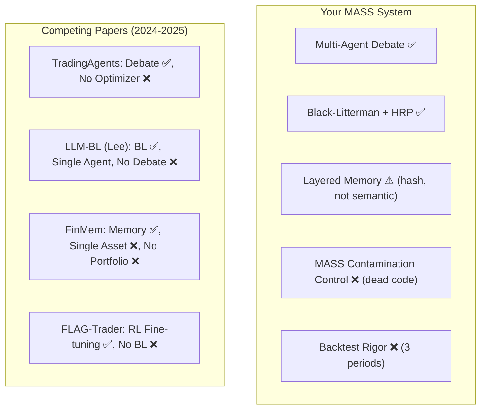

# Research Paper Viability Assessment: MASS Multi-Agent Portfolio System

## TL;DR Verdict

**Yes, this is worth writing a research paper on — but NOT in its current state.**

The *architectural concept* is genuinely publishable and sits at a competitive frontier. However, the *current implementation* has several critical gaps that any reviewer would catch immediately. Below is a brutally honest breakdown and a roadmap to turn this into a defensible paper.

---

## 1. What You Have That's Genuinely Good

### ✅ Strong Architectural Thesis
Your core insight — **decoupling LLM qualitative reasoning from deterministic convex optimization** — is the right one, and it's being validated independently by top labs:

| Paper | Venue | Similarity to Your Work |
|-------|-------|------------------------|
| **LLM-Enhanced Black-Litterman** (Lee et al.) | ICLR 2025 Workshop | LLM → BL views pipeline. Very close to yours, but single-agent, no debate |
| **TradingAgents** (Xiao et al., UCLA/MIT) | arXiv Dec 2024 | Bull/Bear adversarial debate agents. Very close, but no convex optimizer backend |
| **Multi-LLM Sentiment + BL** | Discover AI, Aug 2025 | Multi-LLM → LSTM → BL. Different aggregation mechanism |
| **AlphaAgents** | arXiv Aug 2025 | Role-based multi-agent equity research |
| **FinMem** (Yu et al.) | IEEE TKDE 2024 | Your stated baseline — single-asset, no portfolio optimization |
| **FLAG-Trader** (Yu et al.) | ACL 2025 | FinMem team's own follow-up with RL fine-tuning |

> [!IMPORTANT]
> **Your unique combination** — adversarial multi-agent debate (Bull/Bear/Orchestrator) **+** Black-Litterman/HRP convex optimizer **+** layered memory — is NOT exactly replicated by any single paper above. Each covers 1-2 of these components, but none unifies all three. This is a publishable delta.

### ✅ Optimization Engine is Real
[`optimization_tools.py`](file:///home/yagya/official_works/minor_project/multi_agent_portfolio/tools/optimization_tools.py) is mathematically correct. BL → max_sharpe() → HRP fallback is properly implemented with PyPortfolioOpt. This is the strongest component.

### ✅ Well-Articulated Problem
The documentation correctly identifies real failure modes of naive LLM trading (covariance blindness, autoregressive hallucination, sycophancy). This framing is academically sound.

### ✅ Professional Documentation
The [`MASTER_PROJECT_DOCUMENTATION.md`](file:///home/yagya/official_works/minor_project/multi_agent_portfolio/MASTER_PROJECT_DOCUMENTATION.md) and [`technical_report.md`](file:///home/yagya/official_works/minor_project/multi_agent_portfolio/technical_report.md) are at a quality level that most undergraduate projects never achieve.

---

## 2. Critical Issues That Would Sink a Paper Submission

### 🔴 Issue 1: MASS Masking Protocol is Dead Code

[`simulation.py`](file:///home/yagya/official_works/minor_project/multi_agent_portfolio/simulation.py) contains `mask_financial_text()` and `simulate_masked_environment()`, but **neither function is ever called** by [`main.py`](file:///home/yagya/official_works/minor_project/multi_agent_portfolio/main.py) or [`backtest_engine.py`](file:///home/yagya/official_works/minor_project/multi_agent_portfolio/backtest_engine.py).

**Impact:** Your agents always see real ticker names (TSLA, MSFT, etc.). The LLM's pre-training knowledge about "TSLA dropped 45% in Q4 2022" is fully accessible during backtesting. The technical report claims MASS "prevents memorized LLM look-ahead bias," but this is **not true in the codebase**. Any reviewer who runs `grep -r "mask_financial_text" *.py` will immediately see this.

### 🔴 Issue 2: Memory Embeddings Are Non-Semantic

In [`memory_tools.py`](file:///home/yagya/official_works/minor_project/multi_agent_portfolio/tools/memory_tools.py), `SimpleHashEmbeddingFunction` uses **SHA-256 → 384-dim float vector**. This produces zero semantic similarity — two texts meaning the same thing ("Tesla stock crashed" vs "TSLA shares plummeted") will have completely unrelated vectors.

**Impact:** The "relevancy" component in your composite scoring formula $S = \alpha R + \beta S + \gamma I$ is **mathematically meaningless**. The memory system is effectively a recency+importance queue, not a semantic retrieval engine. Calling it "FinMem-style" is inaccurate — FinMem uses actual language model embeddings.

### 🔴 Issue 3: Backtesting is Statistically Insufficient

- **Only 3 rebalancing periods** over 6 months — far below the standard for financial research
- **No walk-forward validation**, no out-of-sample holdout
- **No transaction costs** modeled
- **Sharpe ratio (1.60), daily volatility (2.36%), max drawdown (-17.11%)** appear in the report but **no code computes these metrics** — they appear to have been calculated externally or manually
- **Period 2 underperformed equal-weight** (25.01% vs 38.74%) — this is downplayed in the report
- **The pre-selection agent is hard-overridden** in [`backtest_engine.py`](file:///home/yagya/official_works/minor_project/multi_agent_portfolio/backtest_engine.py) to always return the same 5 stocks

### 🟡 Issue 4: Screening & Fundamentals Are Stubs

- [`screening_tools.py`](file:///home/yagya/official_works/minor_project/multi_agent_portfolio/tools/screening_tools.py) is a hardcoded lookup table (3 sectors × 10 tickers)
- [`backtest_data/fundamentals.json`](file:///home/yagya/official_works/minor_project/multi_agent_portfolio/backtest_data/fundamentals.json) has only PE ratio and profit margin for 5 tickers × 3 dates = 30 data points
- [`backtest_data/news.json`](file:///home/yagya/official_works/minor_project/multi_agent_portfolio/backtest_data/news.json) has 2 hand-written headlines per ticker per period (30 total)

### 🟡 Issue 5: Incomplete `requirements.txt`

Missing: `chromadb`, `pypfopt`, `json_repair`, `scipy` — all imported in the code but not listed. `duckduckgo-search` is listed but never imported.

---

## 3. Competitive Positioning — Where You Stand

> [!TIP]
> **Your competitive advantage**: You are the only system that combines adversarial debate + convex portfolio optimization + layered memory. But each competing paper does its ONE thing much more rigorously than you do yours. To publish, you need to close the quality gap on at least the top 3 issues.

---

## 4. Publishability Roadmap — What to Fix

### Priority 1: Fix Memory Embeddings (2-3 days)
Replace `SimpleHashEmbeddingFunction` with a real embedding model. Options:
- `sentence-transformers/all-MiniLM-L6-v2` (free, 384-dim, runs locally)
- ChromaDB's built-in default `all-MiniLM-L6-v2`
- Or use your Ollama endpoint for embeddings

This single fix makes the entire memory system actually work as described.

### Priority 2: Integrate MASS Masking (1-2 days)
Wire `mask_financial_text()` into the agent pipeline. Every text that flows to an LLM agent during backtesting should pass through the masking layer. Then run the backtest WITH and WITHOUT masking and report both results as an ablation study.

### Priority 3: Expand Backtesting (1-2 weeks)
- Extend to at least **12 monthly rebalancing periods** (ideally 24)
- Add a separate **out-of-sample test period** (e.g., May 2023 – Dec 2023)
- Implement code to compute Sharpe, volatility, max drawdown, Calmar ratio **programmatically**
- Model at least basic transaction costs (10-20 bps per trade)
- Add an ablation: run the system WITHOUT the debate (single agent), WITHOUT memory, and WITHOUT BL (just equal-weight the debate outputs) to show each component's contribution

### Priority 4: Add Ablation Studies (3-5 days)
A strong paper needs these ablation experiments:

| Experiment | What It Proves |
|-----------|---------------|
| Full system vs. No debate (single analyst) | Value of adversarial reasoning |
| Full system vs. No memory | Value of layered memory |
| Full system vs. Equal-weight (no BL) | Value of convex optimization |
| Full system vs. No masking | Value of contamination control |
| BL-only vs. HRP-only | Fallback mechanism contribution |

### Priority 5: Minor Fixes (1 day)
- Complete `requirements.txt`
- Add position-size constraints to the optimizer (e.g., max 40% single stock)
- Add task `context=` dependencies in CrewAI for explicit information flow
- Log which optimizer (BL vs HRP) was used each period

---

## 5. Target Venues

| Venue | Fit | Notes |
|-------|-----|-------|
| **AAAI Workshop on AI in Finance** | ⭐⭐⭐⭐ | Best fit — values novel architectures, tolerates smaller experiments |
| **ACL FinNLP Workshop** | ⭐⭐⭐⭐ | NLP + Finance intersection, FinMem team publishes here |
| **ICAIF (ACM Intl. Conf. on AI in Finance)** | ⭐⭐⭐ | Expects more rigorous backtesting |
| **IEEE TKDE / IEEE Access** | ⭐⭐ | Would need much larger experiments |
| **NIT Raipur Minor/Major Project** | ⭐⭐⭐⭐⭐ | More than sufficient for academic project submission |

> [!NOTE]
> For an undergraduate academic project submission at NIT Raipur, the current system — with the fixes from Priority 1-2 — is already very strong. For a peer-reviewed publication at a workshop or conference, Priorities 1-4 are essential.

---

## 6. Final Verdict

| Dimension | Score | Comment |
|-----------|-------|---------|
| **Novelty of Architecture** | 8/10 | Unique combination, validated by concurrent independent work |
| **Implementation Correctness** | 5/10 | Optimizer is solid; memory is broken; masking is unused |
| **Experimental Rigor** | 3/10 | 3 periods, no ablations, unreproducible metrics |
| **Documentation Quality** | 9/10 | Excellent — exceeds the implementation quality |
| **Paper Potential (after fixes)** | 7/10 | Workshop-level paper with clear contribution |

> [!IMPORTANT]
> **Bottom line**: The *idea* is paper-worthy. The *current implementation* is not. Fix the memory embeddings, integrate the masking protocol, expand the backtest, and add ablation studies. That transforms this from a strong undergrad project into a publishable contribution to the field.
